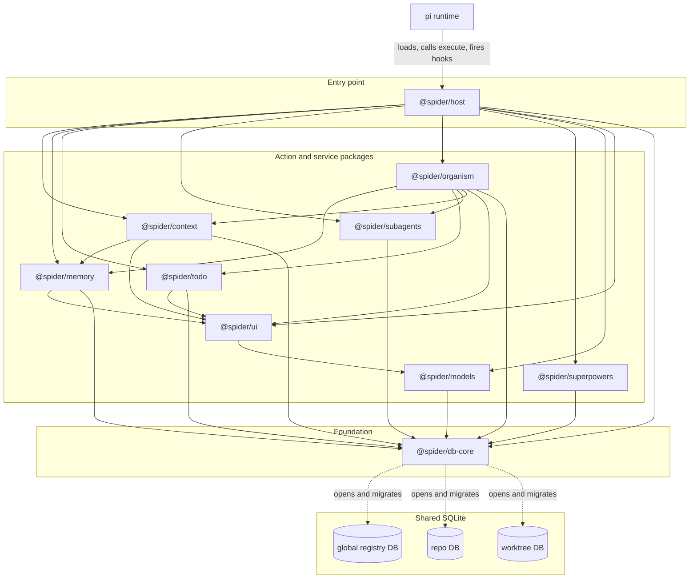
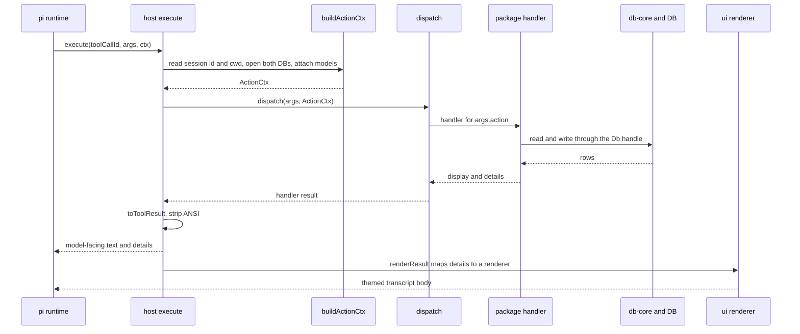

# Architecture overview

Spider is one pi coding-agent extension. It puts memory, unified search, todos,
subagents, sandboxed execution, web fetch, and a skills library on one shared
SQLite database. This document describes the shape of the system. It covers the
one tool the agent calls, the layered packages behind it, the database they all
share, and the path a call takes from tool invocation to rendered result.

For the tables those packages read and write, see
[`data-model.md`](./data-model.md). For the feedback and learning loops that run
on top of them, see
[`feedback-and-learning-loops.md`](./feedback-and-learning-loops.md). This
document does not repeat either one.

## The one-tool model

The agent has one tool, named `spider`. Every operation is an `action` on that
tool: `search`, `remember`, `recall`, `exec`, `exec_file`, `batch`, `index`,
`fetch`, `run`, `kill`, `todo`, `skill`, `import`, `message`, `control`, `loop`, and `schedule`.
`@spider/host` holds the tool definition, its parameter schema, and the list of
valid actions. The schema is in `extension.ts` and the validated action set is in
`dispatch.ts`.

`control` adds a second level of routing for admin commands. `spider control
<command>` reaches `doctor`, `config`, `memory`, `stats`, `models`, `insights`,
`migrate`, `skill curate`, and `upstream-watch`. The `control` handler lives in
host because it spans several packages.

Slash commands are a thin front end for the same actions. `/todos` and `/agents`
open live overlays. `/spider`, `/search`, `/memory`, `/insights`, `/learn`,
`/doctor`, and `/stats` forward to `dispatch` and use the same renderers as a
tool result, so a slash result looks the same as the matching tool result.
`/loop` and the `loop` and `schedule` actions share a session-local scheduler in
host. They wait on external work. They do not wait on subagents, because
subagent completion notices arrive automatically. Host routes these actions
before it resolves the database. Their timers end on shutdown, including
`/reload`. See [Loops and scheduled wakeups](../guide/loop-and-schedule.md).

## Layered package structure

The ten packages have a dependency order, leaves first. A package imports only
from packages below it.

| Layer | Package | Role |
| --- | --- | --- |
| Foundation | `@spider/db-core` | Opens and migrates the three database tiers, defines the schema, resolves a project, and runs the `run_events` bus. Has no `@spider/*` dependency. |
| Model routing | `@spider/models` | The model catalog, tiers, selection, and one-shot completion. Depends on `db-core` for the `Db` type and the shared runtime thinking policy. Does not open databases. |
| Rendering | `@spider/ui` | Pure themed renderers and TUI components. Takes plain data and a theme and returns strings. Uses only types from `@spider/models` and `db-core`, plus `pi-tui` display helpers. The host passes in thinking enums, supported levels and normalized default refs as plain data. Has no runtime database dependency and does not use the pi extension API. |
| Action and service | `@spider/memory` | Structured memory: staging, approval, the active snapshot, and embeddings. Depends on `db-core` and `ui`. |
| Action and service | `@spider/todo` | Durable per-session todos and the `/todos` overlay. Depends on `db-core` and `ui`. |
| Action and service | `@spider/context` | Unified search, sandboxed exec, the content store, fetch, and session import. Depends on `db-core`, `memory`, and `ui`. |
| Action and service | `@spider/subagents` | Subagent dispatch in single, chain, parallel, and pipeline modes, plus intercom. Depends on `db-core`. |
| Action and service | `@spider/organism` | The drain, passes, curator, and learning graph. Depends on `db-core`, `memory`, `todo`, `subagents`, `context`, and `ui`. |
| Action and service | `@spider/superpowers` | The vendored skills library, the managed `AGENTS.md` block, and upstream-watch. Depends on `db-core`. |
| Entry point | `@spider/host` | The pi extension that pi loads. Registers the `spider` tool, dispatches each action, renders results, and wires up slash commands, hooks, routing, and the agents UI. Depends on every other package. |

Two rules keep this structure sound. First, `@spider/ui` is a set of pure
functions. It never opens a database and never calls the pi API, so any package
can render output without pulling in storage or the host. Second, `@spider/host`
is the only package that depends on pi, and nothing in the monorepo depends on
host. The action and service packages do not call each other to fetch data.
They read and write shared tables through the `Db` handle that `db-core`
returns. That makes the database, not any one package, the place where the
packages meet.

## The shared database

`@spider/db-core` owns all three database tiers. Which tier holds a table
depends on what the data must outlive:

- The **global** registry is at `~/.pi/agent/spider/spider.db`. It tracks every
  project spider has seen, plus session bindings, the message queue, insights,
  and model stats.
- The **repo** database is at `<git-common-dir>/spider/repo.db`. It holds `memory`,
  skills, and curator state. Every worktree of the same repository shares it,
  so a convention learned in one worktree is known in the others.
- The **worktree** database is at `<worktree-root>/.spider/project.db`. It holds
  that worktree's sessions, todos, indexed content, runs, event log, and
  embedding state.

Spider keys a project by its **worktree root**, not by the git common directory.
Keying by the common directory put every worktree of a repo on one registry row,
while each worktree wrote its own `db_path`. Opening one worktree then rewrote
another's entry. Directories outside git fall back to the worktree tier.

Every package that reads or writes data opens a connection through `db-core`
(`resolveProject`, `openGlobal`, `openRepo`, `openProject`, `openDbAt`) and works
with the returned handle. `openRepo` takes a **git common dir**, not a working
directory. Packages coordinate by writing rows that another package reads
later, not by calling each other. `spider search` can find all of the
following: content the routing loop indexes, memory the write pipeline stages,
runs the subagent dispatcher records, and summaries the organism writes.
[`data-model.md`](./data-model.md) documents the schema, the migration ladder,
and the `run_events` bus.

## Master interaction diagram

The diagram shows the ten packages, the three database tiers, and the pi runtime. Solid
arrows are dependency edges: a package imports the package its arrow points to.
The dotted edges are the data path. `db-core` opens and migrates all three
databases, and every package that touches storage reaches them through the
handle `db-core` returns.

## How one call flows

A single `spider` tool call passes through host into a package handler, then
back out through a renderer. The steps below follow `execute` in
`packages/host/src/extension.ts` and `dispatch` in
`packages/host/src/dispatch.ts`.

1. pi calls the tool's `execute(toolCallId, args, signal, onUpdate, ctx)`.
2. `execute` reads the session id and working directory from the pi context
   (`sessionIdOf`, `cwdOf`) and calls `buildActionCtx`. `buildActionCtx`
   resolves the project, opens the per-project and global databases through
   `db-core`, and attaches the `@spider/models` router. The result is one
   `ActionCtx` for this dispatch, with `db`, `runDbPath`, `globalDb`, `project`,
   `sessionId`, `cwd`, `pi`, and `models`. For `run`, `kill`, and `message`,
   `db` is the run database of the dispatching session, or its `/bind` target
   when the session is bound. The same helper that mounts `/agents` resolves it.
   An explicit `run` cwd still chooses the child's working directory, scratch
   files and target model defaults. Other actions, which do not record runs,
   use the target project's database when given an explicit cwd.
3. `dispatch(args, ctx)` checks `args.action` against the known set and looks
   up the handler registered for it. Handlers register through `registerAction`.
   `@spider/context` registers `exec`, `exec_file`, `batch`, `index`, `fetch`,
   `search`, and `import`. `@spider/subagents` registers `run` and `message`.
   `@spider/memory`'s logic backs `remember` and `recall`, `@spider/todo` backs
   `todo`, `@spider/organism` backs `skill`, and host itself owns `control`.
4. The handler works on the context databases through the `db-core` handle
   and returns a loose shape (`{ text?, display?, details?, error? }`).
5. `toToolResult` turns that return value into pi's tool result. The result has
   a text block for the model, with ANSI codes stripped, plus the structured
   `details` payload. The model sees only the text block. No `@spider/ui`
   component reaches the model text.
6. Separately, `renderSpiderResult` maps `details` to a `@spider/ui` renderer to
   build the themed transcript body, and `renderSpiderCall` renders the title
   of the call while it runs.

Slash commands run the same `dispatch` path. They render through the same
`renderSpiderResult`, by way of the `spider.command` message renderer.

Two paths run outside this per-call flow. The first is the set of pi lifecycle hooks
that host registers:

- On the first user or custom-message `before_agent_start`, host freezes the
  memory snapshot for the session in the `spider_memory` prompt section.
- On `session_start`, host upserts the session.
- On `resources_discover`, host contributes skill paths.
- On compact and shutdown, host runs the organism drain.

The second is a routing layer over every non-spider tool call. It scrubs
secrets, scans for injection, and auto-indexes large output.
[`feedback-and-learning-loops.md`](./feedback-and-learning-loops.md) describes
both paths, together with the subagent and learning loops.
Pi saves the injected global and repo memory in session files and can include it
in HTML and JSONL exports. Read [Data and privacy](../../README.md#data-and-privacy)
before you share transcripts.

## See also

- [`data-model.md`](./data-model.md): the three database tiers, the tables, migrations,
  and the `run_events` bus.
- [`feedback-and-learning-loops.md`](./feedback-and-learning-loops.md): the
  routing, memory, organism, and subagent loops that run on the shared database.
- [`../../packages/db-core/README.md`](../../packages/db-core/README.md)
- [`../../packages/models/README.md`](../../packages/models/README.md)
- [`../../packages/memory/README.md`](../../packages/memory/README.md)
- [`../../packages/todo/README.md`](../../packages/todo/README.md)
- [`../../packages/context/README.md`](../../packages/context/README.md)
- [`../../packages/subagents/README.md`](../../packages/subagents/README.md)
- [`../../packages/organism/README.md`](../../packages/organism/README.md)
- [`../../packages/superpowers/README.md`](../../packages/superpowers/README.md)
- [`../../packages/ui/README.md`](../../packages/ui/README.md)
- [`../../packages/host/README.md`](../../packages/host/README.md)
