# Data model

Spider stores everything in SQLite, in **three** kinds of database:

- The **global registry database** is at `~/.pi/agent/spider/spider.db`. It
  tracks every project spider has seen and holds global-scope memory and a few
  cross-session tables. It also records session-to-worktree bindings (`/bind`)
  and maps each run ID to the database that owns it. It does **not** hold
  skills or the day-to-day `memory` table. The next two items cover those.
- The **repo database** is at `<git-common-dir>/spider/repo.db`. It holds
  `memory`, skills bookkeeping, and curator state. Every worktree of the same
  repository shares it, so a note or skill learned in one worktree is visible
  from the others. Its key is the git common directory, not any one worktree.
- The **worktree database** is at `<worktree-root>/.spider/project.db`. It
  holds that one worktree's sessions, todos, indexed content, runs, event log,
  and its own embedding state. Its key is the worktree's root directory, so two
  worktrees of the same repo never share this database.

`@spider/db-core` owns all three. It defines the schema, applies migrations,
resolves which files a working directory maps to, and provides the event
helpers. Every other package that reads or writes data opens a connection
through `db-core` and works with the `Db` handle it returns.

`packages/db-core/src/schema.ts` defines the schema as three DDL strings:
`GLOBAL_SCHEMA`, `REPO_SCHEMA`, and `WORKTREE_SCHEMA`. There is no
`PROJECT_SCHEMA` symbol. That was the name before the tiering split. The split
(schema version 7) divided it into `REPO_SCHEMA` and `WORKTREE_SCHEMA`.
`REPO_SCHEMA` took `memory`, `skills`, and `curator_state`. `WORKTREE_SCHEMA`
kept `sessions`, `content`, `todos`, `runs`, `run_events`, and `events`. The
comments in `migrate.ts` mention `PROJECT_SCHEMA` only as history, in migration
steps named for the schema they split away from. The table and column names in
the three DDL strings are the authoritative ones.

`"project"` is a **deprecated alias for `"worktree"`**, not a fourth tier.
`migrate(db, scope)` and the internal `rootFor` in `paths.ts` both treat
`scope === "project"` the same as `"worktree"`. No code reads or writes a
database differently for the literal scope `"project"`. The alias exists so
older call sites that pass `"project"` keep compiling and working.

## Three databases, one process

A working session can touch all three databases. The global database answers
"which project (worktree) am I in, and where are its files". It also stores
memory scoped to `global`. The repo database stores state that must survive the
deletion of any one worktree and be visible from the others. The worktree
database stores records private to the current checkout. The `projects` table
in the global database is the index. Each row records a worktree's key, its
real path, its git common directory (`repo_key`), and the absolute path of its
`project.db` file.

Tables relate by column convention, not by declared foreign keys. Connections
enable `foreign_keys = ON`, but the schema has no `REFERENCES` clauses. Columns
such as `session_id`, `run_id`, and `parent_run_id` link rows by value, and the
database enforces no constraint on them. Since the tiering split, some of these
links cross database files. For example, a worktree-tier `sessions.id` and a
repo-tier `memory.session_id` live in different `.db` files.

## Entity relationship diagram

The diagram below shows the main tables across all three databases. `projects`,
`global_memory`, `upstream_refs`, `message_mirror`, `insights`, `model_stats`,
`session_bindings`, and `run_routes` live in the **global** registry database.
`memory`, `skills`, `curator_state`, and the skill review tables live in the
**repo** database. `sessions`, `content`,
`todos`, `runs`, `run_events`, and `events` live in the **worktree** database.

Runs and run events belong to the worktree of the dispatching session, or to its
`/bind` target. This holds even when `run` sets a different working directory
for the child. The agents view and the child reporter both use that session's
run database.

`vector_map` and `embed_queue` are defined **twice**, once in `REPO_SCHEMA` and
once in `WORKTREE_SCHEMA`. They are two separate tables with the same structure
in two separate files. The repo-tier tables hold embeddings for `memory`. The
worktree-tier tables hold embeddings for `content` and anything else that
worktree embeds. The diagram shows them once.

The link from `projects` to `sessions` is logical, as it was before the split.
A `projects` row names the file that contains those `sessions` rows. It is not
a row-level foreign key. The link from `sessions` to `memory` is a logical
cross-database link for the same reason.

```mermaid
erDiagram
    projects {
        TEXT project_key PK
        TEXT real_path
        TEXT git_common_dir
        TEXT repo_key
        TEXT db_path
        TEXT name
        INTEGER created_at
        INTEGER last_seen_at
        INTEGER session_count
        INTEGER memory_count
    }
    run_routes {
        TEXT run_id PK
        TEXT session_id
        TEXT db_path
    }
    global_memory {
        INTEGER id PK
        TEXT uuid UK
        TEXT category
        TEXT content
        TEXT link
        TEXT scope
        TEXT status
        TEXT source
        REAL confidence
        INTEGER created_at
        INTEGER updated_at
        TEXT justification
        TEXT evidence
    }
    upstream_refs {
        TEXT package PK
        TEXT upstream_repo
        TEXT upstream_ref
        TEXT last_reviewed_commit
        INTEGER last_checked_at
        TEXT notes
    }
    message_mirror {
        INTEGER id PK
        TEXT from_session
        TEXT to_session
        TEXT kind
        TEXT body
        INTEGER created_at
        INTEGER delivered_at
        INTEGER read_at
    }
    insights {
        INTEGER id PK
        TEXT kind
        TEXT a
        TEXT b
        REAL weight
        TEXT payload
        INTEGER created_at
    }
    model_stats {
        INTEGER id PK
        TEXT model
        INTEGER ms
        INTEGER ok
        INTEGER tokens
        INTEGER ts
    }
    session_bindings {
        TEXT session_id PK
        TEXT worktree_root
        INTEGER bound_at
    }
    sessions {
        TEXT id PK
        TEXT parent_session_id
        TEXT name
        TEXT reason
        INTEGER started_at
        INTEGER ended_at
        TEXT summary
        TEXT imported_from
    }
    memory {
        INTEGER id PK
        TEXT uuid UK
        TEXT category
        TEXT content
        TEXT link
        TEXT status
        TEXT source
        REAL confidence
        TEXT session_id
        INTEGER created_at
        INTEGER updated_at
    }
    skill_review_queue {
        TEXT name PK
        TEXT body
        INTEGER attempts
        TEXT last_error
    }
    skill_review_results {
        INTEGER id PK
        TEXT name
        TEXT verdict
        TEXT reason
    }
    skill_review_lock {
        INTEGER id PK
        TEXT token
        INTEGER lease_until
    }
    content {
        INTEGER id PK
        TEXT source
        TEXT path
        TEXT hash
        TEXT heading
        TEXT chunk
        INTEGER is_code
        INTEGER created_at
    }
    todos {
        INTEGER id PK
        TEXT session_id
        INTEGER seq
        TEXT text
        INTEGER done
        INTEGER created_at
        INTEGER updated_at
    }
    runs {
        TEXT id PK
        TEXT session_id
        TEXT parent_run_id
        TEXT agent
        TEXT role
        TEXT name
        TEXT status
        TEXT phase
        TEXT model
        TEXT task
        TEXT thinking
        INTEGER started_at
        INTEGER ended_at
        INTEGER step_count
        INTEGER token_count
        TEXT result
        INTEGER pid
        INTEGER host_pid
        TEXT child_mode
        TEXT intercom_session
        TEXT pid_start_time
    }
    run_events {
        INTEGER id PK
        TEXT run_id
        TEXT session_id
        INTEGER ts
        TEXT type
        TEXT tool
        TEXT summary
        TEXT payload
    }
    events {
        INTEGER id PK
        TEXT session_id
        INTEGER ts
        TEXT phase
        TEXT tool
        TEXT description
        INTEGER added
        INTEGER removed
        TEXT flagged
        TEXT payload
    }
    vector_map {
        INTEGER rowid PK
        TEXT owner_kind
        TEXT owner_id
        TEXT model
        INTEGER dim
        BLOB embedding
    }
    embed_queue {
        INTEGER id PK
        TEXT owner_kind
        TEXT owner_id
        TEXT text
        INTEGER enqueued_at
        INTEGER tries
    }
    skills {
        INTEGER id PK
        TEXT name UK
        TEXT tier
        TEXT category
        TEXT path
        TEXT state
        TEXT status
        TEXT source
        INTEGER pinned
        INTEGER protected
        INTEGER use_count
        INTEGER view_count
        INTEGER patch_count
        TEXT review_reason
        INTEGER created_at
        INTEGER updated_at
    }
    curator_state {
        TEXT scope PK
        INTEGER last_run_at
        INTEGER paused
    }

    projects ||--o{ sessions : "registers worktree DB"
    sessions ||--o{ memory : "session_id (cross-database)"
    sessions ||--o{ todos : "session_id"
    sessions ||--o{ runs : "session_id"
    sessions ||--o{ run_events : "session_id"
    sessions ||--o{ events : "session_id"
    sessions ||--o{ sessions : "parent_session_id"
    runs ||--o{ run_events : "run_id"
    runs ||--o{ runs : "parent_run_id"
```



## Global registry database

`GLOBAL_SCHEMA` defines eight tables.

| Table | Holds |
| --- | --- |
| `projects` | One row per worktree spider has resolved. Columns: `project_key` (primary key, the worktree root), `real_path`, `git_common_dir`, `repo_key` (the git common directory, used to open the repo-tier database), `db_path` (absolute path of the worktree's `project.db`), `name`, `created_at`, `last_seen_at`, and the counters `session_count` and `memory_count`. |
| `global_memory` | Memory scoped to `global`. Columns include `uuid` (unique), `category`, `content`, `link`, `scope` (default `global`), `status` (default `active`), `source` (default `user`), `confidence`, `justification`, `evidence`, and timestamps. |
| `upstream_refs` | Tracking rows for vendored subsystems, keyed by `package`, with `upstream_repo`, `upstream_ref`, `last_reviewed_commit`, `last_checked_at`, and `notes`. |
| `message_mirror` | A cross-session message log: `from_session`, `to_session`, `kind`, `body`, `created_at`, plus `delivered_at` and `read_at`. Both are nullable and are set once a queued message is delivered or read. |
| `insights` | Derived observations: `kind`, a pair of endpoints `a` and `b`, a `weight`, a JSON `payload`, and `created_at`. |
| `model_stats` | Per-call model timing and outcome rows: `model`, `ms`, `ok`, `tokens`, `ts`. |
| `run_routes` | Maps a run ID to its owning session and worktree database path. Lets a session target runs from other sessions. |
| `session_bindings` | One row per bound session: `session_id` (primary key), `worktree_root`, `bound_at`. Stores `/bind` state. `getBinding`, `bindSession`, and `unbindSession` in `bindings.ts` read and write it. |

## Repo database

`REPO_SCHEMA` defines the tables that every worktree of one repository shares,
plus one FTS5 companion table.

| Table | Holds |
| --- | --- |
| `memory` | Repo-scoped structured memory: `uuid` (unique), `category`, `content`, `link`, `status` (default `active`), `source` (default `user`), `confidence`, `session_id` (a worktree-tier session id, linked by convention only), `justification`, `evidence`, and timestamps. |
| `memory_fts` | FTS5 companion table over memory `category`, `content`, and `link` (`uuid` is not indexed). |
| `vector_map` | Embedding storage for this repo database (see [Vector storage](#vector-storage)). |
| `embed_queue` | Pending embedding work for this repo database. |
| `skills` | Skill bookkeeping: `name` (unique), `tier`, `category`, `path`, `state`, `status`, `source`, `pinned`, `protected`, use, view, and patch counters, last-used, last-viewed, and last-patched timestamps, `candidate_body`, `related`, `review_reason`, and timestamps. In the DDL, `tier` defaults to the literal string `'project'`. That default dates from before tiering and was not renamed when the scope names changed to `global`, `repo`, and `worktree`. An index `idx_skills_state` covers `(state, status)`. |
| `skill_review_queue` | Learner proposals that wait for review, with attempts and the last error. |
| `skill_review_results` | Recent review verdicts and reasons. |
| `skill_review_lock` | A review lease shared across processes. |
| `curator_state` | One row per `scope`: `last_run_at` and a `paused` flag. |

## Worktree database

`WORKTREE_SCHEMA` defines the tables private to one worktree checkout, plus
their FTS5 companions.

| Table | Holds |
| --- | --- |
| `sessions` | One row per pi session in this worktree: `id` (primary key), `parent_session_id`, `name`, `reason`, `started_at`, `ended_at`, `summary`, `imported_from`. |
| `content` | Indexed and fetched content chunks: `source`, `path`, `hash`, `heading`, `chunk` text, an `is_code` flag, and `created_at`. |
| `todos` | Durable todos: `session_id`, `seq`, `text`, a `done` flag, and timestamps. |
| `runs` | Subagent runs: `id` (primary key), `session_id`, `parent_run_id`, `agent`, `role`, `name`, `status`, `phase`, `model`, `task`, `thinking`, timing, `step_count`, `token_count`, `result`, `child_mode`, `intercom_session`, `pid_start_time`, `pid`, and `host_pid`. `pid` is the subagent's process id and `host_pid` is the pid of the owning host. Spider records both when it creates the run, before spawn. They let an orphaned background run survive and be reaped safely later. |
| `run_events` | The append-only run event stream: `run_id`, `session_id`, `ts`, `type`, `tool`, `summary`, and a JSON `payload`. |
| `events` | The routing and tracking event log: `session_id`, `ts`, `phase` (`before` or `after`), `tool`, `description`, `added`, `removed`, `flagged`, `payload`. |
| `vector_map` | Embedding storage for this worktree database. It is a separate table from the repo database's `vector_map` (see [Vector storage](#vector-storage)). |
| `embed_queue` | Pending embedding work for this worktree database. It is also separate from the repo database's table. |

### Full-text search companions

Four FTS5 virtual tables mirror text columns for full-text search:

- `memory_fts` (repo database) over memory `category`, `content`, and `link`.
- `sessions_fts` (worktree database) over session `name`, `summary`, and
  `content`.
- `content_fts` (worktree database) over content `source`, `heading`, and
  `chunk`.
- `todos_fts` (worktree database) over todo `text`. It is an external-content
  table (`content=todos, content_rowid=id`), so it stays in sync with `todos`.

### Vector storage

Embeddings live in two places, and both are separate from the FTS tables. Each
database that needs embeddings has **its own copy** of both tables. The repo
database has a `vector_map` and an `embed_queue` for `memory` embeddings. The
worktree database has its own, separate `vector_map` and `embed_queue` for
`content` and other worktree-scoped embeddings. The global database has neither
table.

- `vector_map` is a plain table with a BLOB column. It stores each embedding as
  raw little-endian `float32` values, with the kind and id of the owning row,
  the model that produced it, and the dimension. This form allows brute-force
  cosine similarity and lets spider re-embed from the source text.
- A `vec0` virtual table named `vectors` provides indexed vector search. It is
  not part of `REPO_SCHEMA` or `WORKTREE_SCHEMA`, and no static DDL defines it.
  `Db.loadVec()` creates it on demand with
  `CREATE VIRTUAL TABLE IF NOT EXISTS vectors USING vec0(embedding float[384])`.
  The first call on a connection loads the `sqlite-vec` extension. Later calls
  on the same connection do nothing.

## Migrations and user_version

The schema version is `SCHEMA_VERSION = 13`, defined in
`packages/db-core/src/migrate.ts`. Each database records its own version in the
SQLite `user_version` pragma. `migrate(db, scope)` accepts the `scope` values
`"global"`, `"repo"`, `"worktree"`, and the deprecated alias `"project"`. It maps
`"project"` to `"worktree"` before anything else runs.

`migrate` reads `user_version` and does nothing if the value is already equal
to or greater than `SCHEMA_VERSION`. Otherwise it runs one transaction:

- **Fresh database (`user_version` 0).** It applies the full DDL for the scope
  (`GLOBAL_SCHEMA`, `REPO_SCHEMA`, or `WORKTREE_SCHEMA`). The full schema
  already includes every column, so a fresh database never needs the
  incremental steps.
- **Existing database (`user_version` between 1 and `SCHEMA_VERSION - 1`).** It
  walks each version from `current + 1` up to `SCHEMA_VERSION` and applies the
  incremental steps for that version. The steps are keyed by database kind
  (`GLOBAL_MIGRATIONS`, `REPO_MIGRATIONS`, or `WORKTREE_MIGRATIONS`). A version
  that added nothing to a given database has no steps for it.

The current version history is as follows:

- **Global.** v5 adds `message_mirror.delivered_at`/`read_at` and an index. v6
  adds `projects.repo_key`. v9 creates `session_bindings` for databases that
  predate it. A fresh global database already has the table from
  `GLOBAL_SCHEMA`, so this step exists only for upgrades. The step is keyed at
  9, not 8, on purpose. A database already at `user_version` 8 would otherwise
  hit the `current >= SCHEMA_VERSION` early return and never get the table.
- **Repo.** v7 is the tiering split itself. The repo database comes into
  existence and takes `memory`, `skills`, and `curator_state` from what used to
  be the per-project database. No DDL runs at v7 for repo scope, because a v7
  repo database is created fresh from `REPO_SCHEMA`. v8 creates `memory_fts` if
  it is missing and fills it again from `memory`. That repairs repo databases
  that an earlier build stamped as v7 without creating the FTS table.
- **Worktree.** v2 adds `runs.thinking`. v3 is the point where skills moved out
  to the repo tier, with no DDL for worktree scope at v3. v4 adds `runs.pid` and
  `runs.host_pid`. v7 is this side of the tiering split. `sessions`, `content`,
  `todos`, `runs`, and `events` stay, and `memory` and `skills` leave. No DDL
  runs at v7 for worktree scope either, for the same reason as the repo v7.

- **Global v10.** Repairs a missing `projects.repo_key` left by older install bootstrap code.
- **Global and repo v11.** Adds the memory provenance columns `justification` and `evidence`.
- **Repo v12.** Adds `skills.review_reason` and the skill review queue, results, and lease tables.
- **Global v13.** Adds `run_routes`, so a session can target runs from other sessions.
- **Repo v13.** Runs the idempotent review-table creation again to repair earlier v12 databases that were left incomplete.
- **Worktree v13.** Makes sure `runs.child_mode`, `intercom_session`, and `pid_start_time` exist.

After all steps run, `migrate` sets `user_version` to `SCHEMA_VERSION`.

## The event bus

`packages/db-core/src/events.ts` provides two append helpers and an in-process
publish/subscribe bus. Both `run_events` and `events` are worktree-tier tables.

- `appendRunEvent(db, e)` inserts one row into `run_events` and schedules the same
  event on `bus` through `db.afterCommit`. A `RunEvent` carries `runId`,
  `sessionId`, `ts`, `type`, `tool`, `summary`, and an arbitrary `payload`, which
  is serialized to JSON on write.
- `appendEvent(db, e)` inserts one row into `events` (the routing and tracking
  log) and schedules a derived event on `bus` through `db.afterCommit`. The emitted
  `type` is `tool_intent` when `phase` is `before` and `tool_result` when `phase` is
  `after`.
- `bus.on(listener)` subscribes and returns an unsubscribe function.
  `bus.emit(event)` calls every listener. The bus catches an error thrown by a
  listener, so one bad listener does not stop the others.

Both append helpers publish only after the outermost `Db.transaction` commits.
A nested savepoint that succeeds merges its callbacks into the parent queue. A
rollback, including a failed COMMIT, discards the affected callbacks. In
autocommit mode, publication is immediate. The queue belongs to one `Db`
connection, and listeners run outside the committed transaction. If a listener
opens its own wrapper transaction, that transaction commits and publishes
before the rest of the original callbacks run.
If a queued callback fails, the error goes to stderr. The committed transaction
does not throw, and later callbacks still run. Print-mode children discard
stderr, so these errors are not visible there.

`db.raw` transactions bypass this queue, and so do raw savepoints. Do not emit
bus events or register `afterCommit` callbacks inside raw transactions. Do not
nest raw and wrapper transactions together. Either can publish before commit or
keep callbacks for writes that were rolled back. Use `Db.transaction` when event
publication must follow the transaction. The guarantee does not cover `db.raw`.

Two read helpers cover the tracking log. `listEvents(db, opts?)` returns rows
filtered by `tool`, `phase`, or both, with an optional `limit`.
`eventCountsByTool(db)` returns counts per tool.

The bus is per process and lives in memory. It is not persisted. The
`run_events` and `events` tables are the persistent record.

## Path resolution

`packages/db-core/src/paths.ts` computes the on-disk locations.

- The global root is `~/.pi/agent/spider`. `SPIDER_GLOBAL_ROOT` overrides it. The override must be
  absolute (drive-qualified or UNC on Windows). A relative value, including a Windows root-relative
  path, stops spider from loading with `paths: SPIDER_GLOBAL_ROOT must be absolute; received "<value>"`.
  Spider treats an empty value as unset. The registry database is `spider.db` inside the global root,
  and cached models live under `models`.
- `worktreeRoot(cwd)` resolves `git rev-parse --show-toplevel` from `cwd`. If
  `cwd` is not inside a git repo, or git is not available, it falls back to the
  real path of `cwd`. A worktree root's data directory is
  `<worktree-root>/.spider` (`projectRoot(cwd)`), and the worktree database is
  `project.db` inside it. The key for this directory is the worktree root, not
  the literal `cwd` passed in. Running from a subdirectory of a worktree still
  resolves to the same `.spider`.
- `repoRoot(cwd)` resolves `git rev-parse --git-common-dir` from `cwd` and
  returns `<git-common-dir>/spider`, or `undefined` outside a git repo. The repo
  database is `repo.db` inside that directory. `openRepo(repoKey)` in
  `registry.ts` opens it. `openRepo` takes a repo key (the git common dir) that
  the caller has already resolved, and does not decide what to do when there is
  none.
- `paths.scratch(scope, cwd?)` and `paths.logs(scope, cwd?)` return the
  `scratch` and `logs` subdirectories of the matching root. Scopes other than
  global require a `cwd`. For `"repo"` scope, if `cwd` is not inside a git repo,
  there is no repo root, so these two helpers fall back to the worktree root.
  `"project"` and `"worktree"` always resolve to the worktree root.

`packages/db-core/src/registry.ts` resolves which project (worktree) a working
directory belongs to. `resolveProject(cwd)` takes the real path of `cwd` and
computes **two independent keys**:

- `projectKey = worktreeRoot(cwd)` is the worktree root. This key, not the git
  common directory, keys a `projects` row. Two worktrees of the same repository
  therefore get two separate rows and two separate `project.db` files instead
  of colliding on one.
- `repoKey = gitCommonDir(cwd)` is `undefined` outside a git repo.

The worktree database path is `<projectRoot(realPath)>/project.db`.
`resolveProject` upserts a row keyed by `projectKey` into `projects`, stores
`repoKey` in the same row, and returns a `ProjectInfo`.

`resolveProject` also takes an optional `sessionId`. It can auto-bind the
session to the resolved worktree root. It does this only when all three of
these hold: the caller is not resolving from an explicit `cwd`
(`opts.explicitCwd` is false), no binding exists yet for that session, and
`cwd` itself is not inside a git repo. So binding *promotes* a session that
started with no git context. It does not *switch* a session that already has
git context.

The registry functions open connections:

- `openGlobal()` opens the registry database.
- `openProject(projectKey)` opens a worktree database after a registry lookup.
- `openRepo(repoKey)` opens the repo database at a known git common directory.
- `openDbAt(absPath, scope?)` opens an explicit path. When the scope is
  omitted, it infers the scope from the path. The default is `"worktree"`
  unless the path is the global database.
- `openProjectByPath(realPath)` opens a worktree database directly, without a
  registry lookup.

Each of these migrates the database before it returns it.

## Native module ABI

- `better-sqlite3` is a Node addon. Install or rebuild it for the ABI of the Node that runs pi.
- `sqlite-vec` supplies a platform-specific SQLite extension library. It is not an addon compiled against the Node ABI at install time.
- [Requirements](../../README.md#requirements) lists the supported installation steps and tested Node versions.
- See [Install-time native checks](runtime-lifecycle.md#install-time-native-checks) for diagnostics, reload behavior, and how SQLite failures and vector-extension failures differ in effect.
- Native modules are not checked into the repo. `better-sqlite3` tries a prebuild, then falls back to `node-gyp` when needed.

## Binding and legacy tier migration

- A session normally resolves its project from its working directory.
- `/bind <path>` pins a session to a worktree when the session started without git context.
- Binding promotes a session. It does not automatically switch a session whose git context conflicts.
- Preview a migration of a pre-tiering install before you apply it:

```text
spider control command:"migrate"
spider control command:"migrate" apply:true
```

- The default is a dry run and changes no data.
- Applying the migration creates backups under the global root's `backups/` directory.
- The migration reports rows that collide across worktrees, such as two skills with the same name, as `ambiguous` and leaves them in place.
- [Memory and learning](../guide/memory-and-learning.md) covers memory storage caps and reviewer behavior.

## See also

- [`../../packages/db-core/README.md`](../../packages/db-core/README.md), the
  package reference for the API described here.
- [`./README.md`](./README.md), the system architecture overview.
- [`./feedback-and-learning-loops.md`](./feedback-and-learning-loops.md), how
  memory, routing, and the organism loop use these tables.
