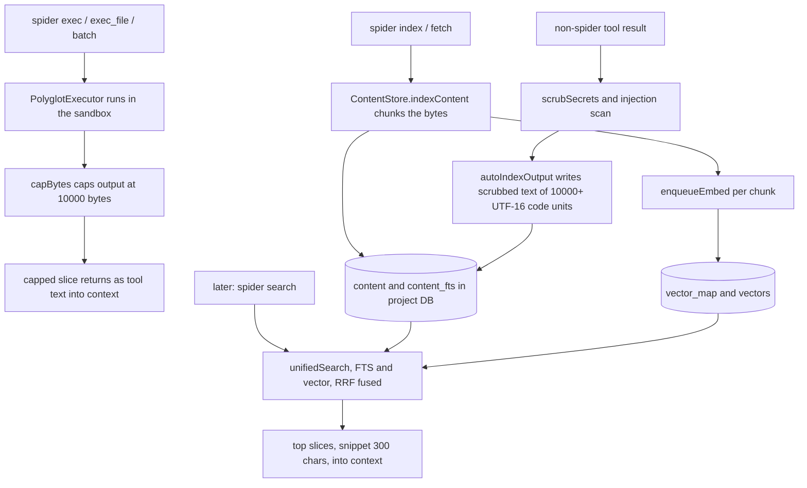
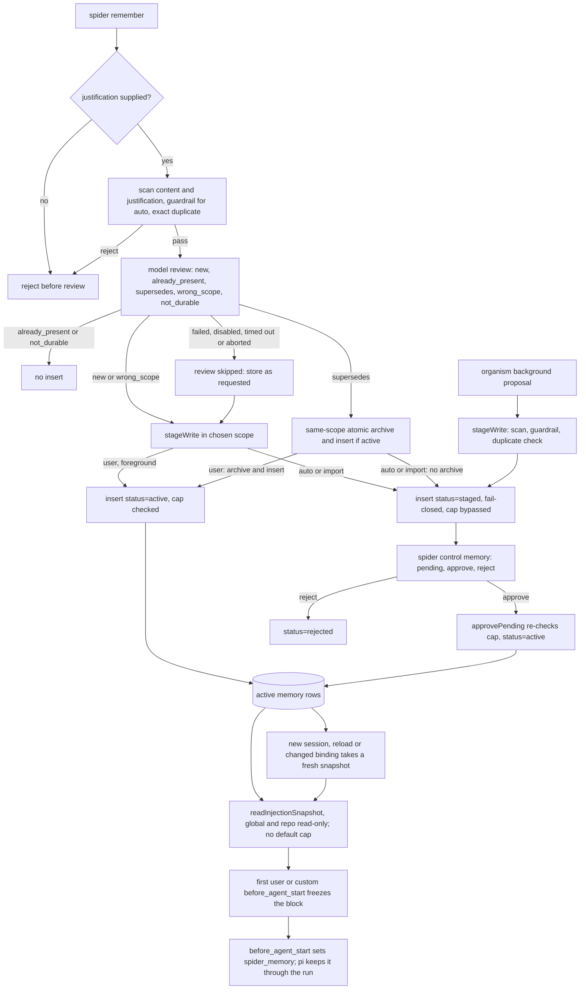
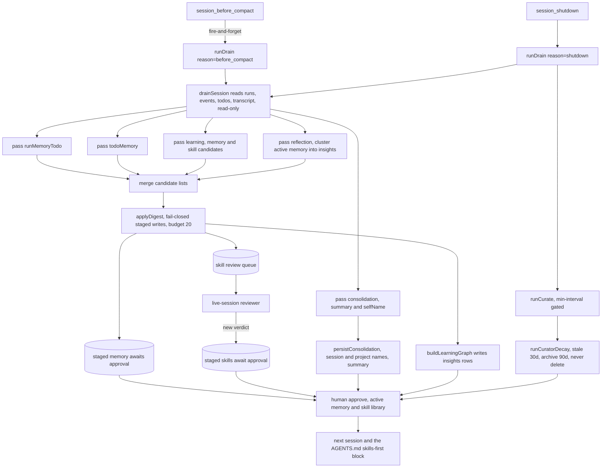
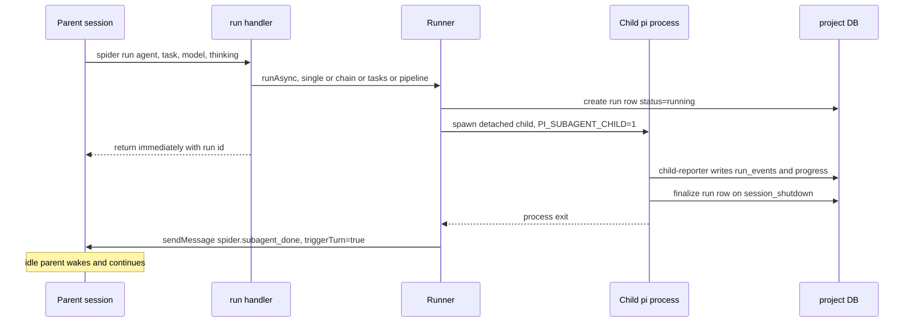
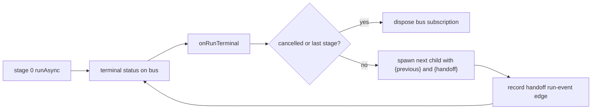

# Feedback and learning loops

Spider runs four loops on top of one shared SQLite database. Together they keep
the model context window small and carry knowledge from one session to the next.
An explicit `spider` action or a specific pi lifecycle hook starts each loop, so
the triggers are predictable and the loops do not overlap by accident.

The four loops are:

1. **The routing loop.** Sandboxed commands return capped output. Explicit
   indexing and auto-indexing of large non-spider results store text in the
   database. `spider search` retrieves indexed text later.
2. **The memory lifecycle.** A foreground `remember` write needs a justification
   and goes through a review of durability, overlap, and scope before it
   becomes active. If the review itself fails or is unavailable, the write is
   stored as requested. Auto-sourced and background writes are staged
   fail-closed and wait for approval.
   The first `before_agent_start` freezes active memory in the `spider_memory`
   prompt section. Pi keeps the section for all requests in the run. New
   sessions take a fresh snapshot.
3. **The organism feedback and learning loop.** On before-compact and on
   shutdown, the organism drains the finished session. It runs passes that
   propose memory and skill candidates. It stages memory and queues skills for
   review. It records a summary and a self-name for the session, curates the
   skill library, and rebuilds the learning graph.
4. **The subagent loop.** `spider run` dispatches a child pi process and returns
   at once. The child reports completion through a `spider.subagent_done`
   message that wakes the parent. Pipelines start later stages in new children
   with the previous stage's result in their tasks.

## Trigger reference

| Trigger | Kind | What it drives |
| --- | --- | --- |
| `session_start` | pi hook | Insert a row into the project `sessions` table (host hook). Start queued skill review in top-level sessions (organism hook). |
| `before_agent_start` | pi hook | Freeze the session's memory snapshot on first use and set its `spider_memory` section for user and idle custom-message runs. |
| `tool_call` / `tool_result` | pi hook | Record intent, scrub secrets, scan for injection, auto-index large non-spider output. |
| `session_before_compact` | pi hook | Start an organism drain with `reason: "before_compact"` and do not wait for it. |
| `session_shutdown` | pi hook | Wait for an organism drain with `reason: "shutdown"`, then run curator decay. |
| `spider exec` / `exec_file` / `batch` | action | Run code in the sandbox and return a capped slice. |
| `spider index` / `fetch` | action | Chunk content into the `content` table and enqueue embeddings. |
| `spider search` | action | Fused full-text and vector retrieval over the database. |
| `spider remember` / `recall` | action | Write or read structured memory. |
| `spider run` | action | Dispatch a subagent (single, chain, parallel, or pipeline). |

---

## 1. The routing loop

Sandboxed execution caps the text returned to the model. Content indexing
stores full text for later search. Auto-indexing copies large non-spider
output into the same store without replacing the tool result.

The three paths handle output differently:

- **Sandboxed execution.** `spider exec`, `exec_file`, and `batch` run code
  through the `PolyglotExecutor` in the project working directory. The handler
  caps the returned text with `capBytes` at `MAX_EXEC_OUTPUT_BYTES` (10,000
  bytes). The full structured result is available as `details`, but only the
  capped slice of stdout and stderr returns as the tool text that enters
  context. Spider does not index exec output automatically. To search it, save
  it to a file and index that file.
- **Content indexing.** `spider index` and `spider fetch` pass content to
  `ContentStore.indexContent`. It splits the content into chunks in the
  `content` table and copies them into `content_fts`. `enqueueEmbed` queues
  each chunk for embedding. The action returns a one-line count, not the
  content.
- **Auto-indexing of tool output.** The host routing layer watches tool results
  other than `spider` and its structured adapters. When the scrubbed text is at
  least `autoIndexThreshold` (default 10,000) UTF-16 code units,
  `autoIndexOutput` writes it into `content`/`content_fts` under a `tool:<name>`
  source.

On the same `tool_result` path, `processToolContent` runs `scrubSecrets` and a
prompt-injection scan before anything is indexed, so secrets never enter the
recall corpus. The `tool_call` path records intent through
`sanitizeIntentPayload`. That function replaces fields that carry content with
size and count metadata. For example, a `content` string becomes
`contentBytes`. The `events` log therefore stores what ran and where, never the
full bytes.

Retrieval closes the loop. `spider search` calls `unifiedSearch`, which does
the following:

1. Runs full-text queries across `memory`, `content`, `session`, and `todo`.
2. Adds vector KNN results for `memory`, `content`, and `session` when an
   embedder is available.
3. Merges the lists with reciprocal-rank fusion.
4. Reranks the results by query proximity.
5. Returns each hit as a snippet of at most 300 characters.

The agent pulls back only the slices that match the current question.

---

## 2. The memory lifecycle

Memory holds structured, categorized notes at repo or global scope. A record
has one of six categories (`preference`, `convention`, `tool-quirk`, `failure`,
`correction`, `insight`), content, an optional link, a status, and a source. The
lifecycle depends on where a write comes from.

**Foreground writes are reviewed before insertion.** `spider remember` requires
a `justification`. It must explain why the fact stays true after the task, how
it helps other agents, and why the requested scope is right. The host `remember` action passes an authenticated
`@spider/models` `complete()` reviewer into `reviewedWrite` in the memory package.
Four checks run before any model call: the deterministic justification check,
the strict threat scan, the background-only guardrail, and the exact-duplicate
check. The reviewer sees the candidate and relevant active entries from both
scopes. It finds repo entries through sanitized FTS. It finds global entries
through sanitized token matching, because the global table has no FTS. Its
verdict can do one of the following:

- Insert as requested (`new`).
- Reuse an active UUID (`already_present`).
- Insert the entry and archive active entries in the same scope, atomically,
  through the FTS-aware path (`supersedes`).
- Insert under a corrected scope (`wrong_scope`).
- Leave a task-only fact in the conversation and insert nothing (`not_durable`).

If the verdict is invalid, the review times out or is aborted, the model is
unavailable, or the reviewer is disabled, the write is stored as requested. The
result reports `review skipped` with the reason. A supersedes verdict for an
auto-sourced write stages the new entry and reports the pending supersessions,
but archives nothing. Entries in the other scope can be related to the new
entry but are never archived. Inserted memory rows store the justification.
That includes staged writes and wrong-scope redirects. Verdicts that insert
nothing store no justification.

`stageWrite` is still the synchronous insert path for background callers.
Reviewed writes call it after validation. A user write with no `autoStage` is
inserted as `status: "active"`, subject to the per-scope character cap. If the
write would push the scope's active content over `DEFAULT_MEMORY_CHAR_CAP`
(8,000 characters), `assertWithinCap` throws `MemoryOverflowError` and no row is
written.

**Background and auto writes stage fail-closed.** A write with
`source: "auto"`, `source: "import"`, or the `autoStage` option is always
inserted as `status: "staged"`, whatever the caller asked for. The scan still
runs first. The guardrail rejects background writes that describe negative tool
claims, transient errors, or failures specific to one environment. A staged
insert skips the character cap on purpose, because nothing staged is active
yet. Staged rows do not appear in `listActive`, `recall`, or the snapshot. All
three read only rows with `status = 'active'`.

**Approval promotes a staged write.** A human reviews staged writes with
`spider control memory` (`pending`, `approve`, `reject`). `approvePending`
checks the cap again at approval time. An approval can therefore still fail
with `MemoryOverflowError` if the scope filled up while the write was staged.
Rejection sets `status: "rejected"`. Nothing is hard-deleted. Rejected and
archived rows stay in the table, and spider removes them only from the FTS
mirror.

The active snapshot is frozen per session in the named `spider_memory` prompt
section. `before_agent_start` sets that section for user and custom-message
runs, and pi 1.2.0 keeps it for all provider requests in the run. The host
hooks and `control doctor` use one `readInjectionSnapshot` function. It
resolves session bindings from the global DB, opened read-only. It then reads
active memory from the global and repo tiers separately, again with read-only
opens. It does not register projects, migrate schemas, or write memory. A
broken tier cannot hide the entries of the other tier, and doctor reports the
failing tier as unreadable.

Snapshot assembly puts preference and correction directives before
observations. Within each priority band it groups entries by tier and category.
There is no default snapshot cap, so every active entry is injected. An
optional explicit `memory.snapshotCharCap` limit skips entries that do not fit
and keeps packing smaller ones. When a configured cap omits rows, snapshot
assembly appends `Memory snapshot: N entries omitted.` Doctor reports this as a warning
and does not fail its check.

`before_agent_start` sets `systemPromptOptions.sections.spider_memory` when
memory is non-empty. When memory is empty, it deletes only that key. It returns
no full prompt. If an earlier extension already forced the prompt, spider
appends the frozen block to that forced prompt, but only when the block is not
already there. Later extensions must keep the current prompt when they compose
theirs.

Pi stores unchanged section text once and appends patches when the section
changes. Compaction can also copy the current section into its system-prompt
checkpoint. Session files and HTML or JSONL exports therefore contain the
injected global and repo memory, including older values. Review them before
you share them.

- The first `before_agent_start` freezes the memory text, even when the text is
  empty. User turns and idle completion notifications use the same hook.
  Queued work, tool cycles, steers and follow-ups keep the byte-identical
  section. They do not keep a cached copy of another extension's prefix.
- New writes, approvals, supersessions and cap changes are stored at once, but
  they enter the prompt in the next session. Recall and doctor still read the
  current rows, so doctor's current counts can differ from an existing
  session's frozen block.
- Spider rebuilds the block when the session ID or file changes, the working
  directory changes, the extension reloads, or the memory binding target
  changes. The hook checks the read-only binding on each call. On turns where
  nothing changed, it does not read active memory or config again.
- Each subagent session freezes its own block. The host `session_start` hook
  inserts the session row that the organism later drains.

---

## 3. The organism feedback and learning loop

The organism turns a finished session into durable knowledge. It never runs on
the foreground request path. `registerOrganism` attaches three lifecycle hooks
(`session_start`, `session_before_compact` and `session_shutdown`) and
builds one `OrganismWorker`. The host skips registration when
`PI_SUBAGENT_CHILD=1`. In children, worker execution and the manual `distill`,
`approve`, `reject`, curation and insights actions refuse to run. Children can
still use `skill list`, `view`, and `add` directly against the repo DB, without
an organism worker. An `add` runs the foreground skill reviewer, which can
call a model.

By default, background completions use `github-copilot/gpt-6-luna` with `low`
thinking, never the session model. Explicit `auxiliary.background_review.model`
and `.provider` settings override the default. An override that sets only the
provider selects `<provider>/gpt-6-luna`. A bare model id must match exactly one
available catalog entry, under the configured provider if one is set. The
session provider is not used for this match. If the selected model is not
available, the drain records a model error and fails with no fallback.

**Triggers.** `session_before_compact` starts a drain with
`reason: "before_compact"` and does not wait for it. The hook never returns
`false`, never calls a cancel API, and swallows every error, so it cannot block
or change compaction. `session_shutdown` waits for a drain with
`reason: "shutdown"` and then runs `runCurate`. The `OrganismWorker` runs every
entry point through one in-flight chain. Two drains, such as a before-compact
drain and a shutdown drain, never run against the database at the same time,
and neither do a drain and a curate. When `organism.enabled` is `false`,
`runDrain` returns a zeroed summary at once.

**Drain.** `drainSession` reads the session's `runs`, `run_events`, `events`,
and `todos`, its stored name, and the normalized conversation when a transcript
path exists. It collects them into a `DigestBundle`. It only reads, and leaves
the event log intact.

**Passes.** The worker runs a set of passes. A per-pass toggle in
`OrganismConfig.passes` turns each one on or off. An error while resolving the
model fails the drain and is recorded. Each pass runs inside its own try/catch,
so a pass that throws does not stop the others. Its error stays in the drain
report. The passes are:

- **runMemoryTodo.** Summarizes subagent run activity and asks the aux model
  for durable memory and follow-up todo candidates. Emits no skills.
- **todoMemory.** Turns completed todos into durable memory candidates.
- **learning.** Runs the aux model over the transcript with the combined review
  prompt and the "do not capture" block. It proposes memory and skill
  candidates with equal weight, and proposes nothing by default. It keeps
  typed skill names and bodies verbatim. The apply step validates and queues
  skill candidates, and the live-session runner reviews them later. The
  learner does not patch existing skills.
- **consolidation.** Writes a session summary of one to three sentences and a
  short self-name slug for the ongoing task. Emits no candidates.
- **reflection.** Clusters active repo memory by vector proximity and asks the
  model to combine each dense cluster into one umbrella `insight`. Returns an
  empty result when no embedder is available.

`shouldCapture` filters every memory candidate from these passes. It enforces
the six-category taxonomy and the anti-poisoning rules.

**Staging versus curation.** These are two different mechanisms.

Staging is what `applyDigest` does to the merged candidates. Nothing becomes
active directly. A shared `WriteBudget` (default 20 per drain) pays for writes.
Each memory stage costs one unit, and each skill accepted into the queue costs
one unit. Memory goes first. Skills must pass deterministic checks and the
`organism.maxSkillProposals` limit (default 1) before they enter the repo
`skill_review_queue`. The drain never calls the skill reviewer, and its receipt
counts `skillsQueued`. Only a live top-level session starts the asynchronous
runner, at session start and after a before-compact drain. Shutdown cancels
reviewers that are running before it closes DBs, and never starts new ones.
Children cannot run the queue. An explicit child `skill op=add` uses inline
review.

A repo DB lease allows only one queued review at a time, across handles and
processes. The review has its own timeout (180000 ms by default, configurable
from 1000 to 600000) and its own thinking level (`xhigh` by default). Both
reviewers accept the shared levels `off`, `minimal`, `low`, `medium`, `high`,
`xhigh`, and `max`. The authenticated pi `streamSimple(...).result()` path maps
reasoning in a provider-neutral way. Per-model capabilities follow pi's rule:
fill a missing level from the next level up first, then fall back downward.
Models without reasoning use off. Spider records the requested and effective
levels, and plain notices about caps or adjustments, in
`.spider/logs/reviewer-thinking.jsonl`.
Only a `new` verdict stages the skill, with its review_reason.
Spider removes candidates with any other verdict and records them in the
bounded table of recent results. If the reviewer fails, the candidate stays,
its attempt count goes up by one, and last_error is set. The third failure
drops it and records the reason. Doctor shows the queue length and recent
verdicts. If the rubric or catalog is not available, the learner prompt leaves
out skill guidance, but memory proposals still go through. Disabling skill
review also leaves the guidance out. Raw failures go only to the local
diagnostics log, which rotates at 1 MiB and keeps at most 2 KiB of each raw
reply.

Both reviewer catalogs and the learner guidance have limits:

- At most 150 skills, ordered bundled first, then active, then loaded by pi,
  then the newest staged.
- Descriptions of at most 300 characters.
- A total learner system prompt of at most 180000 UTF-8 bytes, including the
  full runtime rubric.

If the guidance is too large, spider leaves it out and memory learning
continues. The reviewer judges structure, discovery triggers, token efficiency
and anti-patterns. It does not judge evidence from deployment. Skills that
agents write may have up to 1500 words and 16 KB. Learner and curator
validation keeps the limit of 500 words and 8000 bytes. For skills of every
origin, the frontmatter is exactly a name and a "Use when" description. Todos
have no budget limit.

Curation is what `runCurate` does to skills that already exist. On shutdown it
runs `runCuratorDecay`, unless `curatorShouldRun` blocks it. A paused curator,
or less than `minIntervalHours` since the last run, blocks it unless the run is
forced. The walk measures each skill's idle age from its most recent real
activity and applies two cutoffs. Past `staleAfterDays` (default 30), a skill
becomes `stale`. Past `archiveAfterDays` (default 90), it becomes `archived`
and its directory moves into `.spider/skills/.archive/`. Pinned and protected
skills never change state. A skill that was never used is not archived until it
is at least as old as the stale cutoff. Nothing is ever deleted. When
`curator.consolidate` is on and a model is available, `consolidateSkills` runs
a pass that builds umbrella skills and archives the agent-created skills they
absorb or prune. This pass only archives existing skills and never stages
candidates. It ignores any `skills` fields the model returns unasked.

**Self-naming.** After the apply step, `persistConsolidation` writes the
self-name slug to `sessions.name` and the summary to `sessions.summary`, and
keeps `sessions_fts` in sync. Only when `selfNaming` is on, it also sets
`projects.name` if that name is null or empty. It never overwrites a project
name the user set. A guard wraps every write, so a missing table or column
cannot throw on the drain path.

**Learning graph and insights.** When the `insights` pass toggle is on, the
worker rebuilds the learning graph with `buildLearningGraph`. The nodes are the
skills that are not archived and the active repo memories. There are two kinds
of edge:

- Skill-to-skill links from each skill's declared `related` list.
- Memory-to-skill links scored by lexical token overlap, with a bonus when a
  skill name appears verbatim in a memory. Each memory keeps its top four
  scoring skills.

The graph carries a `linkedPct` statistic. Spider stores the graph as node and
edge rows in an `insights` table on the global database. `control insights` builds
the same graph without storing it.

**Feeding the next session and AGENTS.md.** Memory and skill candidates need
human approval before activation. Output carries forward like this:

- Approved staged memory becomes active at once. It enters the frozen
  snapshot at the next session's first `before_agent_start` (loop 2, the memory lifecycle).
- Approved staged skills become active in the skill library.
- The session summary and self-name are indexed into `sessions_fts`, so past
  sessions are searchable and the ongoing task keeps a stable name.
- The project name is set when it had none.
- The `@spider/superpowers` managed block in `AGENTS.md` tells the agent to load
  skills before it acts, so the curated library guides the agent in the next
  session.

---

## 4. The subagent loop

`spider run` dispatches work to a child pi process and returns before the child
finishes. The `run` handler picks the mode from the arguments, checking in this
order: `pipeline`, then `chain`, then `tasks` (parallel), then a single run.
Every mode runs async by design.

**Dispatch and background run.** For a single run, `Runner.runAsync` creates a
run row with `status: "running"` and spawns a detached child through
`buildChildSpawnSpec`. The child's environment has `PI_SUBAGENT_CHILD=1`, the
database path, the run id, and the parent session id. `Runner.runAsync` then
returns the run row at once. For runs that do not name a model or thinking
level, the handler sets the parent's current ones. `qualifyModelProvider`
resolves a bare model id to a provider that the child can authenticate with.

**Reporting back.** Inside the child, `attachChildReporter` listens to the
child's pi events (`tool_execution_start`, `tool_execution_end`, `message_end`,
`turn_start`, `agent_start`, `session_shutdown`). It writes `run_events` and
progress into the shared database, and the parent tails them onto its live
feed. When the child process exits, `Runner.runAsync` finalizes the run row if
the child did not, then calls the async notifier exactly once. The notifier
sends a `spider.subagent_done` message with the curated output and
`triggerTurn: true`. That flag wakes an idle parent, so the conversation
continues without waiting for the user.

**Pipeline handoff.** For a `pipeline`, `PipelineCoordinator.start` spawns stage
0 async and subscribes to the run-events bus. When the current stage finishes
with `done` or `failed`, `onRunTerminal` substitutes its result for `{previous}`
and `{handoff}` in the next stage's task. It starts that stage in a new child,
then records a `handoff` run-event edge. `{task}` resolves to the first stage's
original task text. The expanded task is the handoff. No intercom message is
sent, and nothing blocks and waits. Cancellation ends the pipeline without
starting another stage. The coordinator drops its bus subscription when the
pipeline ends.

---

## How the loops connect

The four loops share the project and global databases, so the output of one
loop becomes input to another:

- The routing loop writes `events`, and the subagent loop writes `run_events`.
  The organism drain reads both tables on before-compact and shutdown.
- The organism stages memory candidates through the same `stageWrite` pipeline
  that the memory lifecycle uses. Once approved, they feed the snapshot frozen
  at the next session's first `before_agent_start`.
- `spider search` can retrieve both the content the routing loop indexes and
  the summaries the organism writes, so a later session can find what an
  earlier one produced.

## See also

- [`./data-model.md`](./data-model.md): the tables, migrations, and the
  `run_events` bus these loops read and write.
- [`./README.md`](./README.md): the architecture overview and the full
  package interaction diagram.
- [`../../packages/organism/README.md`](../../packages/organism/README.md): the
  drain, passes, curator, and learning graph in detail.
- [`../../packages/memory/README.md`](../../packages/memory/README.md): the
  write pipeline, snapshot injection, and capture guardrails.
- [`../../packages/context/README.md`](../../packages/context/README.md): the
  sandbox, content store, and unified search behind the routing loop.
- [`../../packages/subagents/README.md`](../../packages/subagents/README.md):
  the runner, child reporter, and pipeline coordinator.
- [`../../packages/superpowers/README.md`](../../packages/superpowers/README.md):
  the skills library and the managed `AGENTS.md` block the learning loop feeds.
