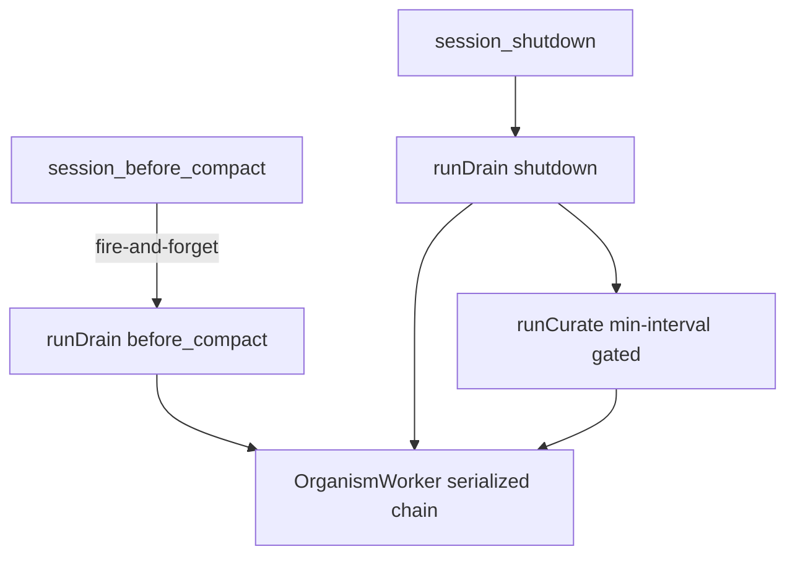
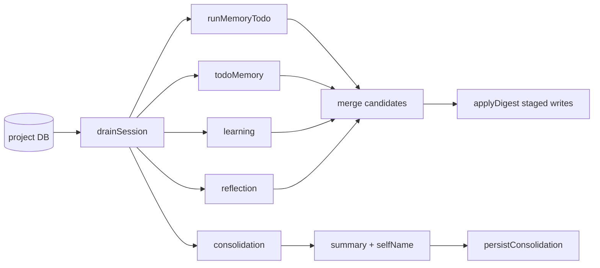

# @spider/organism

This package runs spider's background feedback and learning loop. When a session compacts or shuts down, the organism reads that session's activity. It runs a set of passes that propose durable memory and candidate skills, and it stages those candidates for approval. It also records a summary and a name it picks for the session, curates the skill library, and rebuilds the learning graph, so the next session can use what this one learned.

## Responsibility

This package owns the background work that turns a finished session into durable knowledge:

- **Drain.** Read a session's runs, events, todos, and transcript out of the project DB into a `DigestBundle`. The drain only reads. It changes and removes nothing in the event log.
- **Passes.** Run one or more digest passes over the bundle. Each pass asks an auxiliary model for candidate memory, todos, or skills. The reflection pass first groups memory by vector proximity.
- **Apply.** Send every candidate through a fail-closed staged writer, under a write budget for each drain.
- **Consolidation and self-naming.** Save a short session summary and a short name slug for the ongoing task, and name the project when it has no name that a user set.
- **Curator.** On shutdown, walk the skill library and move idle skills to stale and then to a recoverable archive. Optionally run a consolidation pass with the aux model.
- **Learning graph and insights.** Build a graph of skills and active memory with the edges between them. Optionally save it as `insights` rows for later display.

The organism does **not** approve its own writes. Every memory and skill it produces is staged and waits for a human to approve or reject it. It does not delete skills. The most destructive action it takes is archiving. It does not cancel or alter compaction. It does not write skills itself in the digest passes. The `/learn` path gives the live agent a prompt, and the agent writes the `SKILL.md`.

## Key modules

| File | What it does |
| --- | --- |
| `index.ts` | Public exports and `registerOrganism`, which attaches the worker to the pi host lifecycle hooks. |
| `worker.ts` | `OrganismWorker`, the single in-process worker. It owns the pipeline that drains, runs the passes, applies and persists, and it owns the curator pass. It runs all entry points one at a time, so two runs never use the DB at once. |
| `drain.ts` | `drainSession` reads a session's runs, run events, tracked events, todos, and transcript into a `DigestBundle`. It only reads. |
| `apply.ts` | `applyDigest`, the fail-closed staged writer. It spends a shared `WriteBudget` on memory and skill stages and counts drops and rejections. |
| `passes/run-memory-todo.ts` | Pass 1. Turns subagent run activity into memory candidates and follow-up todo candidates. |
| `passes/todo-memory.ts` | Pass 2. Turns completed todos into durable memory candidates. |
| `passes/learning.ts` | Pass 3. Turns the transcript into staged memory candidates and skill candidates with equal weight. It applies the "do not capture" guardrails and the class-level skill-name rule. |
| `passes/consolidation.ts` | Pass 4. Turns the transcript and runs into a session summary and a self-name slug. Emits no candidates. |
| `passes/reflection.ts` | Pass 5. Clusters active memory by vector proximity and combines each dense cluster into one umbrella insight. |
| `curator.ts` | The deterministic decay walk (stale or archive, by idle age), the minimum-interval gate, file archiving, and the opt-in consolidation prompt for the aux model. |
| `learn.ts` | `buildLearnPrompt` and `AUTHORING_STANDARDS` for the `/learn` skill-authoring handoff. |
| `learning-graph.ts` | `buildLearningGraph` builds skill and memory nodes with skill-to-skill and memory-to-skill edges, and can save them as `insights`. |
| `aux-model.ts` | `createDigestModel` and `parseCandidates`. They build a `DigestModel` from context and parse an aux-model reply into typed candidates, tolerating format errors. |
| `skill-usage.ts` | `SkillStore`. It holds lifecycle state, use, view and patch counters, pin and protect flags, and the staged-candidate flow over the `skills` table. |
| `actions.ts` | `skillAction`, `curateAction`, `insightsAction`. These are the handlers behind the `skill`, `control skill curate`, and `control insights` actions. |
| `config.ts` | `OrganismConfig` and `CuratorConfig`, with defaults and guarded deep-merge readers. |
| `types.ts` | Shared types: `DigestBundle`, `DigestResult`, `DigestModel`, `WriteBudget`, `AppliedSummary`, `PassName`, `DrainReason`. |
| `renderers.ts` | Themed panels for the skill list and view, distill, the curate result, and insights. |

## Public surface

These are the exports from `index.ts`:

- `registerOrganism(host, pi, deps)` builds one `OrganismWorker` and registers three lifecycle hooks (`session_start`, `session_before_compact`, `session_shutdown`).
- `drainSession(db, sessionId, reason, opts)` and `DrainOpts` read a session into a `DigestBundle`.
- `OrganismWorker` and `WorkerDeps` are the serialized worker, with `runDrain` and `runCurate`.
- `runCuratorDecay`, `curatorShouldRun`, `consolidateSkills`, `archiveSkillFiles`, `CURATOR_DEFAULTS`, `CuratorConfig` and `DecayResult` are the curator.
- `buildLearnPrompt` and `AUTHORING_STANDARDS` are the `/learn` handoff.
- `buildLearningGraph`, `tokenize`, `GraphNode`, `GraphEdge` and `LearningGraph` are the learning graph.
- `createDigestModel`, `parseCandidates` and `AuxCall` are the interface to the aux model.
- `SkillStore`, `SkillRow`, `SkillState` and `SkillStatus` are the skill store.
- `skillAction`, `curateAction`, `insightsAction` and their argument and result types are the action handlers.
- `renderSkillList`, `renderSkillView`, `renderDistill`, `renderCurateResult` and `renderInsights` are the renderers.
- `ORGANISM_DEFAULTS`, `readOrganismConfig`, `readCuratorConfig` and `OrganismConfig` are the configuration.
- `AppliedSummary`, `DigestBundle`, `DigestModel`, `DigestResult`, `DrainReason`, `PassName`, `WriteBudget` and `emptyResult` are the shared types.

## How the loop runs

### Triggers: before-compact and shutdown

The host does not register the organism in subagent children (`PI_SUBAGENT_CHILD=1`). Children can use `skill list`, `view`, and `add` directly against the repo DB, without building a worker or a learner. An explicit `add` does run the foreground skill reviewer, in children too. These actions refuse with `organism is disabled in subagent sessions`: `skill distill`, `approve` and `reject`, `control skill curate` (including forced consolidation), and `control insights`. Worker drains and curation also refuse, before they make model calls or write receipts.

Background model calls default to `github-copilot/gpt-6-luna` with `low` thinking, whatever the session model is. Explicit `auxiliary.background_review.model` and `.provider` settings override this default. A provider-only override selects `<provider>/gpt-6-luna`. A bare model id must match exactly one available catalog entry, under the configured provider if one is set. The session provider is not used. If the model is unavailable, the drain is recorded as failed with a model error. There is no fallback to the session model or to another available model.

`registerOrganism` attaches three hooks. `pi.on` chains handlers, so these hooks run alongside any other handlers.

- `session_start` starts queued skill review asynchronously in live top-level sessions.
- `session_before_compact` starts a best-effort drain with `reason: "before_compact"`. It does not wait for the drain, and compaction goes ahead regardless. After the drain completes, it starts queued reviews. The handler never returns `false`, never calls a cancel API, and swallows every error, so it cannot block or alter compaction.
- `session_shutdown` cancels reviews in progress, then awaits a drain with `reason: "shutdown"`, then runs a curator pass if the minimum interval has passed. It swallows errors so that shutdown never breaks.

The `OrganismWorker` runs every entry point through a single chain, one at a time. A second call made while one is running waits in the queue for the earlier one. So a before-compact drain and a shutdown drain, or a drain and a curate, never run against the DB at the same time.

### Drain

`drainSession` reads the session's `runs`, `run_events`, `events`, and `todos` from the project DB, along with the session's stored name. When a transcript path is given and the file exists, it also reads the normalized conversation. It returns a `DigestBundle`. It does not write, and it leaves the event log intact.

### Passes

The worker runs the passes in order. Each pass runs only when its toggle in `OrganismConfig.passes` is on. If model resolution fails, the drain is recorded as failed, not as a successful empty result. Each pass runs inside its own try/catch. If a pass throws, the worker records an error and continues with the remaining passes, and it reports a failed or partial outcome.

1. **runMemoryTodo.** Summarizes subagent runs and their run events, and asks the aux model for durable memory candidates and follow-up todo candidates. Every memory candidate goes through the capture guardrail. Emits no skills.
2. **todoMemory.** Turns completed todos into durable memory candidates. If no todos are done, it returns early without a model call. Emits no skills or todos.
3. **learning.** Runs the aux model over the transcript with the combined review prompt and the "do not capture" block. It emits staged memory candidates and queued skill candidates. The guardrail filters the memory candidates. Skill strings keep their exact formatting for the counted deterministic checks. If skill guidance is missing or disabled, the pass leaves out the skill section and still learns memory.

4. **consolidation.** Produces a session summary of 1 to 3 sentences and a short self-name slug for the broad ongoing task. Emits no candidates. If there is no transcript and no runs, it returns early.
5. **reflection.** Clusters active repo memory by vector proximity and asks the model to combine each dense cluster into one umbrella `insight`. It returns an empty result when no embedder is available or no cluster qualifies.

The worker joins the candidate lists from all passes. The summary and self-name come from the consolidation pass. Memory candidates must use a fixed set of categories. A candidate is kept only when its category is exactly one of `preference`, `convention`, `tool-quirk`, `failure`, `correction`, or `insight`.

### Staging (apply) versus curation

Two different mechanisms decide what survives.

**Staging** is what `applyDigest` does to the merged candidates. It is fail-closed, so nothing becomes active memory or an active skill directly. Each memory stage and each skill queue insert spends one unit of a shared `WriteBudget` (default maximum 20 per drain), memory first and then skills. When the budget runs out, the remaining stageable candidates are dropped and counted, never discarded silently.

- Memory goes through `stageWrite` with `source: "auto"` and `autoStage: true`. A rejected result is counted and uses no budget.
- Skills pass deterministic validation and the proposal cap, then go into a durable repo queue. The drain never waits for deep review. The runner in the live session holds a lease on the repo DB, stages only candidates with a `new` verdict, and records the other verdicts. It keeps failed reviews for up to three attempts. Only human approval activates a candidate. Doctor shows the queue length and recent results. The root README covers the reviewer's thinking and timeout settings, origin ceilings, and the limits on prompt and catalog size.
- Todos are added directly. They do not use the budget, but they are counted.

`applyDigest` returns an `AppliedSummary` with the counts `memoryStaged`, `todosAdded`, `skillsQueued`, `skillsStaged` (zero in learner drains), `dropped`, and `rejected`.

**Curation** is what the curator does to skills that already exist. On shutdown, `runCurate` runs `runCuratorDecay`, unless `curatorShouldRun` blocks it. The curator is blocked when it is paused or when less than `minIntervalHours` has passed since the last run, unless the run is forced. The walk measures each skill's idle age from its most recent real activity and applies two cutoffs. Past `staleAfterDays`, a skill becomes `stale`. Past `archiveAfterDays`, it becomes `archived` and its directory moves to `.spider/skills/.archive/`. Pinned and protected skills never change state. A skill that was never used is not archived until it is at least as old as the stale cutoff. Nothing is ever deleted, and archiving is recoverable. When `curator.consolidate` is on and a model is available, `consolidateSkills` runs a pass that builds umbrella skills. It archives the agent-created skills that it absorbed or pruned, and it checks the pin and protected flags again before each change. The curator only archives. It does not stage new skills.

### Self-naming

The consolidation pass proposes a self-name slug for the ongoing task. After apply, `persistConsolidation` writes the slug to `sessions.name` and the summary to `sessions.summary`. It keeps `sessions_fts` in sync when that table exists. Only when `selfNaming` is on, it also sets `projects.name` if that name is null or empty, so it never overwrites a project name that a user set. Every write is guarded, so a missing table or column cannot throw on the drain path. An empty slug counts as no name.

### Learning graph and insights

After apply, when the `insights` pass toggle is on, the worker rebuilds the learning graph with `buildLearningGraph`. The nodes are the skills that are not archived and the active repo memories. There are two kinds of edge. Skill-to-skill edges come from each skill's declared `related` list. Memory-to-skill edges are scored by how many lexical tokens the two share, with a bonus when a skill name appears word for word in the memory. Each memory keeps the four highest-scoring skills. The graph has a `linkedPct` statistic. When it saves, it writes node and edge rows into an `insights` table in the global DB. `insightsAction` builds the same graph without saving it, for `control insights`.

### How the output feeds the next session

Nothing the organism produces is active until a human approves it. Once approved, it reaches the next session:

- Approved staged memory becomes active. It is injected as part of the memory snapshot, which each session freezes on the first `before_agent_start`.
- Approved staged skills become active in the skill library.
- The session summary and self-name are stored and indexed into `sessions_fts`. Past sessions are searchable, and the ongoing task keeps a stable name.
- The project gets a name when it had none.
- The learning graph is available through `control insights`.

You review staged memory with `spider control memory` and staged skills through the skill approval actions. The `/learn` path is separate. `buildLearnPrompt` returns a prompt that tells the live agent to gather the named sources with its own tools and to stage one skill candidate with the `skill` action's `op:"add"`. The candidate has a name and a final-format SKILL.md with exactly a name and a "Use when" description. Activation is always a separate, explicit `op:"approve"`. The agent never approves its own candidate. There is no `create` operation and no separate path for uploading scripts.

## How it fits

`@spider/organism` depends on these packages:

- `@spider/db-core` for the project and global DBs.
- `@spider/memory` for staged writes, active memory, embeddings and capture guardrails.
- `@spider/todo` to add follow-up todos.
- `@spider/subagents` for run rows and the log breadcrumb.
- `@spider/context` to read the transcript.
- `@spider/ui` for renderers.

`@spider/host` connects it by calling `registerOrganism` with a `WorkerDeps` bundle. The bundle holds the two DBs, the project info, an embedder factory and an aux-model factory. The host can also pass an optional `onSetupError(phase, error, ctx?)` observer. It reports failures that happen before a drain can start: registration itself throwing, a lifecycle event with no session to resolve, or the deps resolver throwing. Without it, these failures are invisible, and a dead organism looks the same as a healthy one that has not drained yet. The host also routes the `skill`, `control skill curate`, and `control insights` actions to the handlers in `actions.ts`. The organism does not run on the foreground request path. It runs on the session lifecycle hooks and on those explicit action calls.

## Notes

- The before-compact hook must never block or cancel compaction. It does not wait for the drain, never returns `false`, and swallows all errors. It does report a failure through `onSetupError` when the failure happens before the drain.
- The master `org.enabled` toggle stops `runDrain` early with a zeroed summary.
- Staged writes are fail-closed and limited by the budget. Candidates over the budget are dropped and counted, not applied silently.
- The curator never deletes. Archiving into `.spider/skills/.archive/` is the most destructive action, and it is recoverable. The deterministic decay walk never changes the state of pinned and protected skills.
- Reflection needs vectors. With no embedder, it returns an empty result instead of failing. If the synthesis reply for a cluster cannot be parsed, the cluster is skipped, but not silently. If every cluster attempted in a pass fails, the drain records a real `reflection` error and never reports a false "completed" with zero proposals. If only some clusters fail, the pass keeps the clusters that parsed and still records the failure.
- Every persistence write on the drain path is guarded, so a schema gap cannot break drain, curate, or shutdown.
- `readLastDrainReport(db, sessionId)` reads the current session's own receipt. `readLastDrainReportForWorktree(db)` is a fallback across the worktree, for a fresh session or runtime that has no receipt of its own yet. Callers must label its result with that receipt's own session id and timestamp, and must never present it as the current session's drain.
- Curator defaults are `staleAfterDays` 30, `archiveAfterDays` 90, `minIntervalHours` 24, and `consolidate` off. Organism defaults are all passes on, self-naming on, and `autoWriteBudget` 20.

## See also

- [`@spider/memory`](../memory/README.md) covers staged writes, active-memory injection, capture guardrails, and embeddings.
- [`@spider/todo`](../todo/README.md) covers the durable todos that the organism reads and adds to.
- [`@spider/subagents`](../subagents/README.md) covers the run rows and the log breadcrumb that the drain reads.
- [`@spider/context`](../context/README.md) covers transcript reading and unified search over the summaries the organism writes.
- [`@spider/superpowers`](../superpowers/README.md) covers the skills library and the managed `AGENTS.md` block that the learning loop feeds.
- [`@spider/host`](../host/README.md) connects `registerOrganism` and routes the organism actions.
- [Feedback and learning loops](../../docs/architecture/feedback-and-learning-loops.md) gives the cross-package view of these loops.
